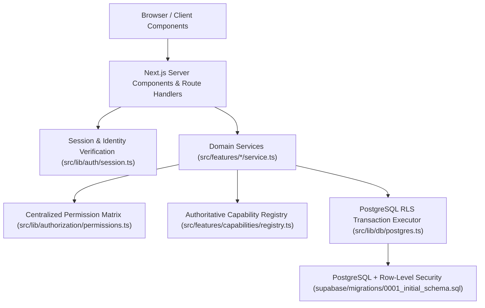

# Circles Platform — System Architecture

## 1. Architectural Pattern: Modular Monolith

Circles is structured as a domain-partitioned **Modular Monolith** built on **Next.js App Router** and **PostgreSQL**. Rather than embedding business rules in UI pages or splitting a first release into premature microservices, all domain logic lives in explicit service modules under `src/features/<domain>/service.ts`.



---

## 2. Dual-Mode Persistence Layer (Supabase + Embedded PostgreSQL)

To ensure that local development, automated integration tests, and production deployments execute against the exact same SQL schema and Row-Level Security (RLS) rules:

- **Production / Cloud Mode**: When `NEXT_PUBLIC_SUPABASE_URL` and `NEXT_PUBLIC_SUPABASE_ANON_KEY` are configured in `.env.local`, `src/lib/db/supabase.ts` connects to Supabase Auth and Supabase PostgreSQL.
- **Local & CI PostgreSQL Mode**: When external Supabase credentials are not present, `src/lib/db/postgres.ts` boots an embedded PostgreSQL engine (`@electric-sql/pglite`) persisted to `.pgdata/` (or isolated in-memory during Vitest suites) and automatically applies `supabase/migrations/0001_initial_schema.sql` and `supabase/seed.sql`.

Every domain operation runs inside `withRlsTransaction(actorUserId, callback)`, which executes:
```sql
SET LOCAL ROLE authenticated;
SELECT set_config('request.jwt.claim.role', 'authenticated', true);
SELECT set_config('request.jwt.claim.sub', $1, true);
```
This guarantees that `auth.uid()` and all PostgreSQL Row-Level Security policies are enforced on every query.

---

## 3. Core Domain Boundaries

| Domain Module | Responsibility |
| --- | --- |
| `src/features/auth` | Registration, scrypt password hashing, signed session tokens, password recovery & reset, profile updates |
| `src/features/circles` | Circle creation from templates, slug normalization & collision handling, visibility & policy reconciliation, discovery search |
| `src/features/memberships` | Public joining, approval-based join requests, invitations, role management, ownership transfer, last-owner protection |
| `src/features/capabilities` | Single authoritative capability registry, dependency graph validation, non-destructive enable/disable, navigation generation |
| `src/features/templates` | Versioned Circle blueprints (`university`, `neighbourhood`, `professional`, `creator`, `learning`, `sports`, `project`, `local_business`) |
| `src/features/spaces` | Topical spaces per Circle, capability association, posting policy enforcement, archival & ordering |
| `src/features/discussions` | Chronological posts, comments, reactions, saved items, space-scoped feeds |
| `src/features/notifications` | Database-backed in-app notifications, idempotent delivery logs, optional Resend transactional email integration |
| `src/features/moderation` | Content reporting, moderation review queue, content removal/restoration, member suspension, audit logging |
